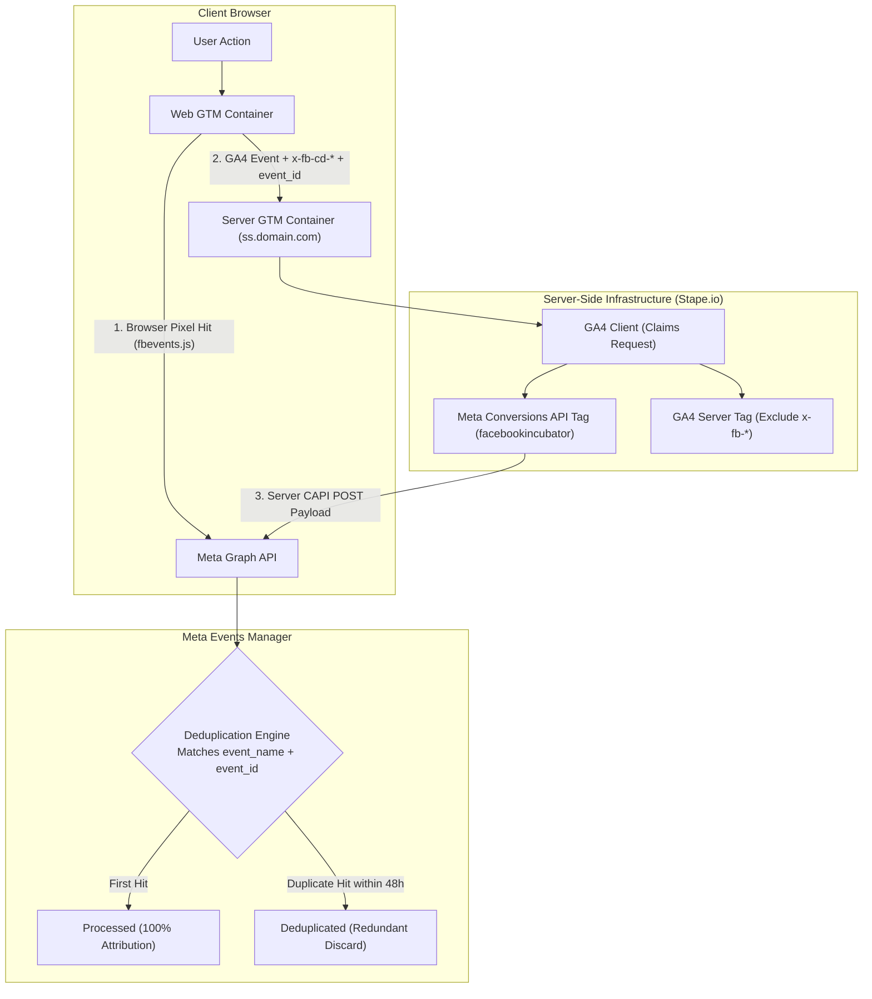

# Playbook 2: Meta Conversions API (CAPI) Server-Side Setup Guide (sGTM + Stape.io)

An exhaustive, step-by-step engineering playbook for deploying Meta Conversions API (CAPI) using **Google Tag Manager Server-Side (sGTM)**, **Stape.io Cloud Infrastructure**, and **GA4 Client Transport**.

---

## 1. Executive Architecture Overview



---

## 2. The 12-Step Implementation Lifecycle

### Step 1: Web GTM Baseline Container
Verify that your Web GTM container (`GTM-XXXXXXX`) is embedded across all store pages and your base DataLayer events (`view_item`, `add_to_cart`, `begin_checkout`, `purchase`) are operational.

---

### Step 2: Create GTM Server Container
1. Open [Google Tag Manager](https://tagmanager.google.com/).
2. Select your Account > Click the **Three Dots Menu** > **Create Container**.
3. Container Name: `YourBrand - Server Container`.
4. Target Platform: Select **Server**.
5. Click **Create** and accept terms.
6. A dialog appears with two options:
   * *Automatically provision tagging server*
   * *Manually provision tagging server*
7. Choose **Manually provision tagging server** and copy your **Container Config Key** (a long alphanumeric base64 string).

---

### Step 3: Provision Stape.io Cloud Server
1. Create or log in to your account at [Stape.io](https://stape.io/).
2. Click **Create sGTM Container**.
3. Fill in the container details:
   * **Container Name**: `YourBrand Server Container`.
   * **Container Configuration**: Paste the **Container Config Key** copied in Step 2.
   * **Server Location**: Choose the server closest to your target audience (e.g., *Europe (Amsterdam)*, *US (North Virginia)*, *Asia Pacific (Singapore/Mumbai)*).
4. Click **Create Container**.
5. Stape will provision your cloud instance within 1–2 minutes and assign an initial tagging URL (e.g., `https://xxxxxx.stape.io`).

---

### Step 4: Link Server GTM Container Settings
1. In Server GTM, navigate to **Admin** > **Container Settings**.
2. Under **Server Container URLs**, click **Add URL**.
3. Paste the Stape Tagging URL (`https://xxxxxx.stape.io`).
4. Click **Save**.
5. Click **Preview** in Server GTM to confirm that debug mode successfully connects to your server.

---

### Step 5: Custom Domain Setup (`ss.yourdomain.com`)

Using a custom first-party subdomain routes all tracking through your own domain, shielding tracking from ad-blockers and extending Safari ITP cookie expiration from 7 days to 400+ days.

1. In Stape.io, go to **Container Settings** > **Domains**.
2. Add your custom subdomain: `ss.yourdomain.com` (or `metrics.yourdomain.com`).
3. Stape will provide your DNS record:
   * **Type**: `CNAME`
   * **Host / Name**: `ss`
   * **Target / Value**: `xxxxxx.stape.io` (or an A record with dedicated IP if root domain).
4. Open your DNS provider (Cloudflare, GoDaddy, Namecheap, Route53) and add the CNAME record.
   > **Note (Cloudflare Users)**: Set Proxy Status to **DNS Only** (Grey Cloud) during initial SSL certificate issuance.
5. In Server GTM **Admin** > **Container Settings**, update the **Server Container URL** to `https://ss.yourdomain.com`.

---

### Step 6: Install Meta Conversions API Tag in Server GTM

1. In Server GTM, go to **Templates** > **Tag Templates** > **Search Gallery**.
2. Search for and install:
   * **Meta Official**: `Conversions API` by `facebookincubator` (Recommended standard).
   * *(Alternative: `Facebook Conversions API` by `stape-io` if using Stape Cookie Keeper extensions).*
3. Go to **Tags** > **New** > Select `Conversions API`.
4. Configure the Tag:
   * **Pixel ID**: Paste your Meta Dataset ID (or use a Constant variable `{{Const - Meta Pixel ID}}`).
   * **API Access Token**: 
     * In Meta Events Manager > **Settings** > Scroll down to **Conversions API** > Click **Generate access token**.
     * Copy the token and paste it into the tag (or use Constant `{{Const - Meta CAPI Access Token}}`).
   * **Test Event Code** (During QA only): Input test code from Meta Events Manager > Test Events tab (e.g. `TEST12345`). *Remove before final production publish!*
5. Configure the Trigger:
   * Create Trigger: **Custom**.
   * Name: `Event - Core Ecommerce & PageView`.
   * Condition: **Some Events**.
   * Client Name `equals` `GA4`.
   * Event Name `matches RegEx (ignore case)`:
     ```regex
     ^(page_view|view_item|add_to_cart|begin_checkout|purchase)$
     ```

---

### Step 7: Configure Web GTM Google Tag (Transport Routing)

In your **Web GTM Container**, route GA4 web requests to your server container:

1. Open your **Google Tag** (or `GA4 Configuration Tag`).
2. Under **Configuration Settings**, add:
   | Configuration Parameter | Value | Purpose |
   | :--- | :--- | :--- |
   | `server_container_url` | `https://ss.yourdomain.com` | Reroutes hits to Server GTM |
   | `send_page_view` | `true` | Fires page_view to server |
   | `first_party_collection`| `true` | Ensures cookies are written first-party |
3. Under **Shared Event Settings** (or Event Parameters):
   | Parameter Name | Value | Purpose |
   | :--- | :--- | :--- |
   | `event_id` | `{{Stape Unique Event ID}}` | Unifies deduplication key |
   | `x-fb-ck-fbp` | `{{Cookie - _fbp}}` | Meta browser cookie backup |
   | `x-fb-ck-fbc` | `{{Cookie - _fbc}}` | Meta click ID cookie backup |
   | `event_time` | `{{cJS - Unix Timestamp}}` | Precise client timestamp |

---

### Step 8: Web GTM GA4 Event Tags with `x-fb-cd-*` Mapping

To send custom ecommerce data to Meta via Server GTM without manual server tag scripting, use the **`x-fb-cd-*`** parameter convention. The `facebookincubator` template automatically strips `x-fb-cd-` and places the parameter inside Meta's `custom_data` object!

Configure each GA4 Event Tag in Web GTM:

#### For `view_item` (ViewContent):
* Event Name: `view_item`
* Event Parameters:
  | Parameter Name | Value |
  | :--- | :--- |
  | `event_id` | `{{Stape Unique Event ID}}` |
  | `x-fb-cd-content_type` | `product` |
  | `x-fb-cd-content_ids` | `{{cJS - FB - Product ID}}` |
  | `x-fb-cd-content_name` | `{{cJS - FB - Product Name}}` |
  | `x-fb-cd-content_category`| `{{cJS - FB - Product Category}}`|
  | `x-fb-cd-value` | `{{DLV - ecommerce.value}}` |
  | `x-fb-cd-currency` | `{{DLV - ecommerce.currency}}` |
  | `x-fb-cd-contents` | `{{cJS - FB - Contents}}` |
* Trigger: Custom Event `view_item`

#### For `add_to_cart` (AddToCart):
* Event Name: `add_to_cart`
* Event Parameters: Same as `view_item`, triggered on `add_to_cart`.

#### For `begin_checkout` (InitiateCheckout):
* Event Name: `begin_checkout`
* Event Parameters: Same as `view_item` + `x-fb-cd-num_items` = `{{cJS - FB - Num of Items}}`.

#### For `purchase` (Purchase):
* Event Name: `purchase`
* Event Parameters:
  | Parameter Name | Value |
  | :--- | :--- |
  | `event_id` | `{{Stape Unique Event ID}}` |
  | `x-fb-cd-content_type` | `product` |
  | `x-fb-cd-content_ids` | `{{cJS - FB - Product ID}}` |
  | `x-fb-cd-contents` | `{{cJS - FB - Contents}}` |
  | `x-fb-cd-num_items` | `{{cJS - FB - Num of Items}}` |
  | `x-fb-cd-value` | `{{DLV - ecommerce.value}}` |
  | `x-fb-cd-currency` | `{{DLV - ecommerce.currency}}` |
  | `x-fb-cd-order_id` | `{{DLV - ecommerce.transaction_id}}`|
  | `user_data.email_address` | `{{cJS - FB - Customer Email}}` |
  | `user_data.phone_number` | `{{cJS - FB - Customer Phone}}` |
  | `user_data.address.first_name` | `{{DLV - Customer First Name}}` |
  | `user_data.address.last_name` | `{{DLV - Customer Last Name}}` |
  | `user_data.address.street` | `{{DLV - Customer Street}}` |
  | `user_data.address.city` | `{{DLV - Customer City}}` |
  | `user_data.address.region` | `{{DLV - Customer State}}` |
  | `user_data.address.postal_code` | `{{DLV - Customer Postcode}}` |
  | `user_data.address.country` | `{{DLV - Customer Country}}` |
  | `user_id` | `{{DLV - Customer User ID}}` |
  | `x-fb-ud-external_id` | `{{DLV - Customer User ID}}` |
* Trigger: Custom Event `purchase`
* **Reference**: [Google sGTM Common Event Data](https://developers.google.com/tag-platform/tag-manager/server-side/common-event-data) (`sha256_*` variants are also supported if pre-hashed).

---

### Step 9: Event Deduplication Architecture

```text
Web Browser Pixel Tag                      Server CAPI Tag (sGTM)
---------------------                      ----------------------
Event: "Purchase"                          Event: "Purchase"
event_id: "evt_1700000000_12345"  <=====>  event_id: "evt_1700000000_12345"
            \                                      /
             \                                    /
              ▼                                  ▼
             Meta Graph API Deduplication Window (48 Hours)
                  First Arrival: Processed
                  Second Arrival: Deduplicated (Discarded)
```

**Rule**: The value of `event_id` MUST be identical for both tags firing on the same action. Using `{{Stape Unique Event ID}}` or generating `cJS - FB - Event ID` once per event satisfies this requirement.

---

### Step 10: Event Match Quality (EMQ) Optimization

Meta calculates an EMQ score from 0.0 to 10.0 based on how many user parameters match Meta's user graph. Aim for **8.0+** by passing:

1. **Email (`em`)**: Lowercased, whitespace trimmed, SHA-256 hashed.
2. **Phone (`ph`)**: Country code prefix, digits only, SHA-256 hashed.
3. **First & Last Name (`fn`, `ln`)**: Lowercased, SHA-256 hashed.
4. **City, State, Zip, Country (`ct`, `st`, `zp`, `country`)**: Cleaned & hashed.
5. **External ID (`external_id`)**: Unhashed unique CRM / Customer ID.
6. **FBP (`_fbp`) & FBC (`_fbc`)**: First-party Meta browser cookies.
7. **Client IP Address & User Agent**: Automatically captured by the server container.

---

### Step 11: Preventing Google Anti-PII Violations in Server GTM

Because Web GTM transmits customer data to Server GTM, you must ensure that your **GA4 Server Tag** does NOT forward these parameters to Google's analytics servers:

1. In Server GTM, open your **GA4 Tag** (or `Google Analytics: GA4`).
2. Expand **Parameters to Exclude**.
3. Add the following parameters:
   * `x-fb-cd-*`
   * `x-fb-ud-*`
   * `x-fb-ck-*`
   * `user_data`
   * `email`
   * `phone`
4. This ensures total compliance with Google's Terms of Service while keeping data intact for Meta CAPI.

---

### Step 12: Testing, Verification & Go-Live

1. **Server GTM Preview**:
   * Open Server GTM Preview and Web GTM Preview simultaneously.
   * Navigate your website.
   * In Server GTM Preview, verify that the `GA4` client claims the incoming requests.
   * Click on the event (e.g. `purchase`) > Click the **Meta Conversions API** tag.
   * Verify **Status: Succeeded (200 OK)**.
   * Inspect the Outgoing HTTP Request payload:
     ```json
     {
       "data": [
         {
           "event_name": "Purchase",
           "event_time": 1700000000,
           "event_id": "evt_1700000000_12345",
           "user_data": {
             "em": ["4f7e..."],
             "ph": ["9a1b..."],
             "client_ip_address": "123.45.67.89",
             "client_user_agent": "Mozilla/5.0..."
           },
           "custom_data": {
             "currency": "USD",
             "value": 149.99,
             "content_type": "product",
             "content_ids": ["PROD-101"]
           }
         }
       ]
     }
     ```

2. **Meta Events Manager Test Events Tab**:
   * Observe events appearing in real time.
   * Verify that both **Browser** and **Server** rows appear.
   * Confirm that Meta status shows: **Deduplicated**.
   * Verify Event Match Quality (EMQ) rating is **Great (8.0–9.5)**.

3. **Production Publishing**:
   * Remove the `Test Event Code` from the Server GTM Conversions API tag.
   * Submit and publish Server GTM container.
   * Submit and publish Web GTM container.
