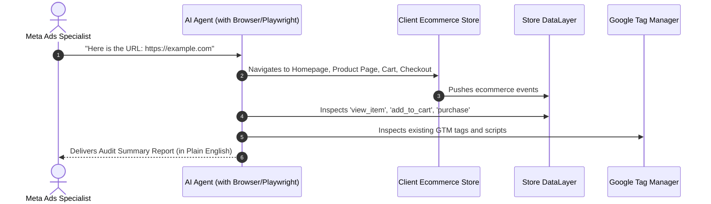

# Complete Meta Pixel & CAPI Implementation Workflow for Meta Ads Specialists

*A practical, step-by-step collaboration blueprint between a Meta Ads Specialist / Media Buyer and an AI Agent using the `meta-pixel-capi` skill.*

---

## Executive Summary

As a Meta Ads Specialist, your primary focus is optimizing ROAS, scaling profitable campaigns, and driving purchases. You do not need to write JavaScript, configure server DNS proxies from scratch, or debug regex triggers manually. 

By leveraging an AI agent powered by the **`meta-pixel-capi`** skill, you act as the **Campaign Architect and Decision Maker**, while the AI agent acts as your **Senior Technical Web Analytics Engineer**.

```mermaid
flowchart LR
    A["Meta Ads Specialist<br/>(Business Objectives & Approvals)"] 
    <--> |"Natural Language & Assets"| 
    B["AI Agent (Antigravity)<br/>(meta-pixel-capi skill)"]
    B <--> |"Automated Inspection & Generation"| 
    C["Store DataLayer, GTM & Meta Events Manager"]
```

---

## 1. Getting Started: How to Kick Off with the AI Agent

You do not need to formulate technical prompts. Simply start by providing the agent with your business goal and the website URL.

### Recommended Kick-Off Prompt
> *"I am a Meta Ads Specialist running paid campaigns for this store: `https://example.com`. The store already has an active ecommerce dataLayer. I need to set up complete, enterprise-grade tracking: Meta Pixel in the browser and Server-Side Conversions API (CAPI) with Stape.io, full event deduplication, and high Event Match Quality (EMQ 8.0+) for Advantage+ Catalog Ads. Please inspect the site and guide me step-by-step."*

### What Information to Share First
1. **The Store Website URL**: (e.g., `https://example.com`).
2. **Your Primary Ad Objectives**: (e.g., *Purchases, Catalog Sales, Dynamic Retargeting, High-Value Leads*).
3. **Current Problem (if any)**: (e.g., *"My reported purchases in Ads Manager are 30% lower than Shopify/WooCommerce backend"*, or *"My EMQ score is only 4.2"*).

---

## 2. Initial Discovery Questions (The Agent's Role)

To protect your live store, the AI agent will trigger its **Mandatory Discovery Gate** and ask you simple, business-friendly questions:

```text
Discovery Questions Asked by the AI Agent:
1. Platform: "What platform does your store run on (WooCommerce, Shopify, Custom)?"
2. Scope: "Do you want Full Hybrid Dual-Tagging (Browser Pixel + Server CAPI), which is recommended for maximum ad attribution?"
3. Server Infrastructure: "Will we be hosting the server container on Stape.io (recommended for 5-minute setup and ad-blocker bypassing) or Google Cloud?"
4. Domain: "Do you have access to your domain DNS (e.g., Cloudflare, GoDaddy) to set up a custom tracking link like ss.yourstore.com?"
5. Template Preference: "Do you want Stape's template (which bypasses ad-blockers like Brave/uBlock to recover 15-20% lost sales) or Meta's official template?"
6. Meta Assets: "Do you have your Meta Dataset/Pixel ID and Conversions API Access Token ready?"
```

---

## 3. Access Requirements & Preparation Checklist

The specialist should prepare or grant the following accesses:

| Platform / Tool | Role / Permission Needed | Where to Find / What to Provide |
| :--- | :--- | :--- |
| **Store Website** | Public URL / Test Order capability | Provide URL. For gated checkouts, provide a temporary 100% discount test coupon. |
| **Google Tag Manager** | **Admin** or **Publish** access | GTM Web Container ID (`GTM-XXXXXX`) and access to the container. |
| **Meta Business Manager** | **Admin** on Events Manager / Dataset | Your 15–16 digit **Dataset / Pixel ID** and a generated **CAPI Access Token**. |
| **Stape.io** | Account / Container access | Login or invite to Stape.io account to provision the server container. |
| **Domain DNS Provider** | CNAME record editing rights | Access to Cloudflare, GoDaddy, Namecheap, etc., to point `ss.yourdomain.com`. |

---

## 4. Website and Tracking Audit

Before creating or touching any tags, the AI agent performs an automated non-destructive audit:



### What the Agent Audits:
1. **DataLayer Quality**:
   * Does `view_item` fire on product pages?
   * Does `add_to_cart` push item ID, price, and currency?
   * Does `purchase` include `transaction_id`, `value`, `currency`, and customer info?
2. **Catalog ID Consistency**:
   * Do the product IDs in the dataLayer (e.g., SKU or Post ID) match the IDs in your Meta Commerce Manager Product Feed? *(Crucial for Advantage+ Catalog Ads)*.
3. **Existing Conflict Check**:
   * Are there third-party plugins (Shopify Facebook App, PixelYourSite, native theme integrations) already injecting an un-deduplicated pixel? *(Prevents double-counting).*

---

## 5. Event Requirements & Parameter Mapping

The agent presents an easy-to-read **Event Matrix** tailored to your ecommerce funnel:

| Funnel Step | Store DataLayer Event | Meta Standard Event | Ad Optimization Impact | Required Parameters |
| :--- | :--- | :--- | :--- | :--- |
| **Page View** | `gtm.js` / Page load | **`PageView`** | Traffic & Custom Audiences | `page_location`, `event_id` |
| **Product View** | `view_item` | **`ViewContent`** | Dynamic Product Retargeting | `content_ids`, `content_type: 'product'`, `value`, `currency`, `contents` |
| **Add to Basket**| `add_to_cart` | **`AddToCart`** | Mid-funnel Retargeting & Optimization | `content_ids`, `value`, `currency`, `contents` |
| **Begin Checkout**| `begin_checkout`| **`InitiateCheckout`** | High-intent retargeting | `content_ids`, `value`, `currency`, `num_items`, `contents` |
| **Completed Sale**| `purchase` | **`Purchase`** | ROAS reporting & ROAS bidding | `order_id`, `value` (numeric), `currency`, `contents`, customer info (`em`, `ph`, etc.) |

---

## 6. Implementation Workflow: The AI Agent Does the Heavy Lifting

To eliminate manual coding for the specialist, the agent follows a **Zero-Manual-Coding Workflow**:

### Phase A: Web Container Setup (Client-Side)
1. **Helper Variables Generation**:
   * The agent creates the 5 standard array transformation variables (`cJS - FB - Product ID`, `cJS - FB - Contents`, `cJS - FB - Num of Items`, etc.) and the deduplication key `event_id`.
2. **Template Import**:
   * The agent installs the selected template (Stape.io Facebook Pixel or Meta Official).
3. **Tag Assembly**:
   * Builds the Base PageView and standard event tags (`ViewContent`, `AddToCart`, `InitiateCheckout`, `Purchase`) mapped to your existing dataLayer variables.
4. **Google Tag Routing**:
   * Sets `server_container_url` to `https://ss.yourdomain.com` and attaches `x-fb-cd-*` parameters to transport data seamlessly to the server container.

### Phase B: Server Container Setup (Server-Side CAPI)
1. **Stape Provisioning**:
   * Connects the GTM Server Container to Stape.io.
2. **Conversions API Tag**:
   * Configures the Meta CAPI tag triggered on `Client Name equals GA4` and ecommerce regex `^(page_view|view_item|add_to_cart|begin_checkout|purchase)$`.
3. **Google Anti-PII Compliance**:
   * Automatically configures the server GA4 tag to exclude `x-fb-*` and customer data parameters.

### Phase C: Instant GTM Container Import
Instead of having you create 20 tags and 15 variables manually:
* The agent generates a complete **`GTM_Meta_Pixel_Ecommerce.json`** file.
* You simply open your GTM container > **Admin** > **Import Container** > Select **Merge** > Done!

---

## 7. Testing & Debugging: Verification in Plain English

The agent guides you through a clear 3-point verification process:

```text
Point 1: Browser Verification (Meta Pixel Helper)
  └── Check: Green icons appear on every page.
  └── Check: Purchase shows exact order total and currency (e.g. INR 1400 or USD 49.99).

Point 2: Server Verification (Server GTM Preview)
  └── Check: GA4 Client claims incoming requests.
  └── Check: Meta Conversions API Tag shows "Status: Succeeded (200 OK)".

Point 3: Meta Events Manager Test Events Tab
  └── Check: Events arrive marked with Source: "Browser" and Source: "Server".
  └── Check: Under the Event Details, status displays: "Deduplicated".
```

---

## 8. Final Validation Gate Before Going Live

Before you hit publish and start spending ad budget, the AI agent reviews this checklist:

- [ ] **100% Value Accuracy**: `value` is sent as a clean number (no currency symbols or commas) and paired with an uppercase 3-letter currency code.
- [ ] **Zero Duplicate Conversions**: Meta Events Manager displays `Deduplicated` for all overlapping browser and server hits.
- [ ] **Catalog Match Verification**: `content_ids` in tracking matches product IDs in your Meta Catalog.
- [ ] **Event Match Quality (EMQ) Score**: Target score is **8.0+** on Purchase (due to hashed email, phone, name, address, and `_fbp`/`_fbc` cookies).
- [ ] **Test Code Cleanup**: The agent confirms that the temporary `TESTxxxxx` code has been removed from the CAPI tag.

---

## 9. Final Deliverables & Documentation Handover

At the completion of the setup, the AI agent provides the Meta Ads Specialist with a permanent handover package:

1. **Executive Architecture Summary**: Plain-English explanation of how your store, GTM, Stape, and Meta connect.
2. **Event & Parameter Mapping Sheet**: A clear table documenting every event, its trigger, and the data it sends to Meta.
3. **GTM Container JSON Backup**: Downloadable `.json` export of the container for disaster recovery or deployment to sister stores.
4. **Maintenance & Monitoring Guide**: Simple quarterly checks to keep tracking at peak health.
